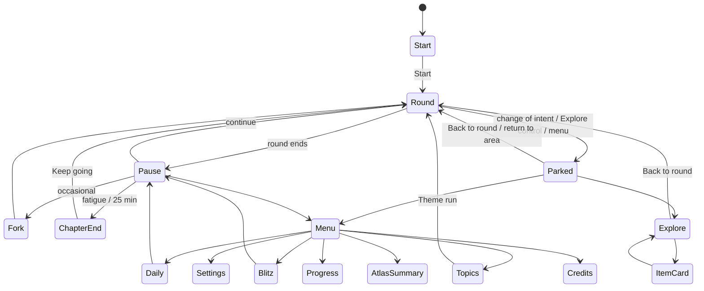

# 06 — UX and design

**Status:** v1.0. Decisions: D12, D24, D32, D57, D69, D76–D78, D121, D123–D125,
D128–D129, D133, D153–D162, D173, D175, D177, D179, D181.

## 1. Principles

1. **The globe is the app.** Controls stay at the edges. The globe is always behind everything.
2. **One thing at a time.** One card on screen, never stacked pop-ups (D32).
3. **Calm, not compulsive.** No "done for today", streak-break or come-back messages. Reminders only when the user turns them on (D69, D78, D177).
4. **Never colour alone.** Every state also has a shape, icon, pattern, text or sound (D125).
5. **Every input is first-class.** Touch, mouse, keyboard, screen reader and switch access can all complete every task.
6. **Mistakes are information.** Neutral wording, no failure sounds, no failure haptics, the correct answer always shown.
7. **Rearrange, don't redesign.** Same parts on every screen size, laid out differently.

## 2. Screens and states

| ID | Screen / state | Type | Feature |
|----|----------------|------|---------|
| S01 | Start: globe, one line, "Start", links to accessibility settings and import, privacy line (D175) | Full screen | FE22 |
| S02 | Globe / flat map (base layer) | Base | FE06, FE08 |
| S03 | Question card, one layout per primitive P1–P9 | Card | FE10 |
| S04 | Answer feedback (inside S03) | Card state | FE11 |
| S05 | Meet card | Card | FE16 |
| S06 | Contrast card | Card | FE16 |
| S07 | Pause (atlas interlude) | Base state | FE08, FE15, FE27 |
| S08 | Chapter end ("A good place to stop"), when fatigued or after 25 min (D179) | Pause state | FE15, FE27 |
| S09 | Interest fork (three destinations) | Pause state | FE20 |
| S10 | "Back to round" tab (parked round) | Edge tab | FE19 |
| S11 | Explore item card | Card | FE19 |
| S12 | Topics list | Sheet | FE19 |
| S13 | Daily challenge: intro, 5 questions, result, share | Card flow | FE21 |
| S14 | Atlas summary (text version of the Living Atlas, D160) | Sheet | FE08 |
| S15 | Menu | Sheet | — |
| S16 | Settings (sections below) | Full screen | FE23 |
| S17 | Your data: export, import, delete everything. Internal and closed builds: share a summary, share my practice log (D151, D180) | Full screen | FE01, FE04, FE23, FE30 |
| S18 | Credits and notices (border notice, D146) | Full screen | FE24 |
| S19 | Another tab is active ("Use here") | Full screen | FE01 |
| S20 | Browser not supported | Static page | — |
| S21 | Storage problem (full, blocked or corrupt) with export option | Full screen | FE01 |
| S22 | Developer panel (internal builds only, D35) | Full screen | FE03 |
| S23 | Progress view (D181) | Full screen | FE28 |

Settings sections (S16, FE23): Learning · Sound and haptics · Display (theme,
high contrast, pattern strength, reduce motion, text size follows device) ·
Map (globe/flat, "Show all names in Explore") · Play (no time pressure,
spelling support, list alternative, keyboard shortcuts) · Colour vision ·
Language and units · Network · Reminders (Android only) · Your data · About ·
Developer (internal builds only).

## 3. Navigation

No tab bar. Three persistent controls sit over the globe:

- **Menu** (top left): Daily challenge, Topics, Progress, Atlas summary, Blitz (when available), Settings, Credits. Weekly rhythm shows here when on. Opening it during a round parks the round (D173).
- **Map controls** (bottom right): zoom in, zoom out, globe/flat switch.
- **Explore** (bottom left): explicit park-and-explore control (D133). Required for keyboard and screen-reader users.

### Back and Escape

| Where | Android Back / Esc |
|-------|--------------------|
| Item card, sheet, menu | Close it |
| Explore (round parked) | Back to round |
| Settings sub-page | Up one level |
| Question card | Opens the menu and parks the round. Never skips or ends the question |
| Pause with nothing open | Android: leaves the app, no "are you sure". Web: nothing |

Web routes exist only for full-screen pages (`/settings/*`, `/data`,
`/credits`, `/progress`) so the browser Back button behaves. Rounds have no URL.

## 4. Layout

| Width (dp / CSS px) | Question card | Globe |
|---------------------|---------------|-------|
| < 600 (phone portrait) | Bottom sheet, ≤ 45% height | Fills the screen above the card |
| 600–839 (phone landscape, small tablet) | Side panel, 360 wide | Remaining width |
| ≥ 840 (tablet, desktop) | Side panel, 400 wide | Centred in remaining width |

- Both orientations supported (WCAG 1.3.4). Usable at 320 CSS px wide and 200% text (1.4.10, 1.4.4).
- Respect safe areas (notches, gesture bar).
- The globe recentres so the question area is never hidden under the card.

## 5. Design tokens

One source: `packages/ui/tokens.ts`, exported as CSS variables and as globe
shader uniforms. Components never use raw values.

### 5.1 Base palette (Okabe-Ito)

| Token | Hex | Notes |
|-------|-----|-------|
| `oi.black` | #000000 | |
| `oi.orange` | #E69F00 | Fills only, never text on light |
| `oi.skyBlue` | #56B4E9 | Fills only, never text on light |
| `oi.bluishGreen` | #009E73 | |
| `oi.yellow` | #F0E442 | Fills only, needs an outline |
| `oi.blue` | #0072B2 | |
| `oi.vermillion` | #D55E00 | |
| `oi.reddishPurple` | #CC79A7 | |

Neutrals: 10-step grey scale per theme (light, dark, high contrast), defined in M0.

### 5.2 Semantic colours

| Token | Colour | Always paired with |
|-------|--------|--------------------|
| `feedback.correct` | blue | Check icon, rising tone, "This is X" |
| `feedback.close` | orange | Target icon, mid tone, explanatory text |
| `feedback.incorrect` | vermillion outline on the chosen place | X icon, soft low tone, text |
| `answer.marker` | reddish purple | MapPin icon, label |
| `focus.ring` | black outer + white inner, 3 px total | Works on any background |
| `beam` (Bearing) | sky blue, 60% opacity | Edge lines |

Rules: text contrast ≥ 4.5:1, large text and UI parts ≥ 3:1 (WCAG 1.4.3,
1.4.11). CI simulates every pair for protan, deutan, tritan and achromat (D140).

### 5.3 Living Atlas states

States differ by **lightness (ΔL\* ≥ 15) and outline style**, not by hue.
The "pattern strength" setting scales textures.

| State | Fill | Outline | Extra cue |
|-------|------|---------|-----------|
| Undiscovered | Dark, muted land | None | — |
| Discovered | Same as undiscovered | Thin solid | — |
| Established | Light fill + soft relief | Solid | Label shown (D121) |
| Fading | Mid fill | Dashed | Fine stipple texture |
| Restored | Established + 800 ms glow | Solid | Static highlight if reduce motion |
| In question | Unchanged | Unchanged | Label always hidden |

Globe background: dark space in both themes (D157). Ocean: dark blue-grey.
Menus, sheets and settings follow the system light/dark setting (D157).

### 5.4 Typography

- **Typeface:** Atkinson Hyperlegible Next, variable WOFF2, self-hosted (D155).
  Latin subset if the licence terms allow it (checked in the ADR). Counts towards the 3 MB budget.
- **Scale (rem, 16 px base):** caption 0.875 · body 1 · body-large 1.125 ·
  title 1.375 · headline 1.75 · display 2.25. Nothing smaller than 14 px.
- Line height 1.5 for body text. Layouts survive WCAG 1.4.12 text spacing.
- Tabular figures for scores and distances.
- Globe labels follow the device text size, clamped to 1–1.6× to avoid overlap.

### 5.5 Spacing, shape, targets

- Spacing: 4 · 8 · 12 · 16 · 24 · 32 · 48 px.
- Radius: 8 (controls), 16 (cards), full (pills).
- Elevation: two levels only. No shadows on the globe.
- **Touch targets: at least 48 × 48 dp / CSS px**, 8 px apart. This is above
  the WCAG 2.5.8 minimum of 24 px.
- Globe tap zones follow D118, not this rule.

### 5.6 Icons

Lucide via `<Icon>` (D123). 24 px, 2 px stroke. Icon-only buttons need an
accessible name and a tooltip. Starting set (names confirmed against the
pinned version in M0):

| Use | Icon |
|-----|------|
| Menu | `Menu` |
| Globe / flat switch | `Globe` / `Map` |
| Explore | `Telescope` |
| Back to round | `ArrowLeft` |
| Zoom | `ZoomIn`, `ZoomOut` |
| Hint | `Lightbulb` |
| Show me | `Eye` |
| Colour names | `Palette` |
| Correct / close / incorrect | `Check` / `Target` / `X` |
| Answer marker | `MapPin` |
| Daily challenge | `CalendarDays` |
| Share | `Share2` |
| Export / import | `Download` / `Upload` |
| Settings | `Settings` |
| Sound | `Volume2` / `VolumeX` |
| Haptics | `Vibrate` / `VibrateOff` |
| Credits | `Info` |
| Progress | `ChartColumn` |
| Blitz | `Zap` |
| Reminders | `Bell` |

## 6. Feedback

| Outcome | Visual | Sound | Haptic (D162) | Text (en-GB example) |
|---------|--------|-------|---------------|----------------------|
| Correct | Blue fill, Check | Soft rising note. Pitch rises with combo (D76) | Light tick | "Peru." |
| Close | Orange, Target | Single mid note | **None** | "Close. It's spelled Peru." Rated Hard; Good with spelling support (D128) |
| Incorrect | Chosen place outlined vermillion with X. Camera moves to the answer, purple pin | Soft low two-note, never a buzzer | **None, ever** | "This is Peru. You chose Ecuador." |
| Show me | Purple pin, no judgement colour | None | **None** | "Here it is: Peru." |
| Bearing | Beam lands, distance counter (D36) | Landing pop | Light tick **on a hit only** | "1,240 km, 12° off." |

- Results are announced through a polite live region.
- Feedback stays for at least 1.2 s (placeholder) before any automatic continue (E01 B, FE27).
- "No time pressure" always means tap to continue (D158).

## 7. Motion

| Token | Duration | Use |
|-------|----------|-----|
| `motion.fast` | 120 ms | Button states |
| `motion.base` | 200 ms | Cards, sheets |
| `motion.slow` | 400 ms | Pause transitions |
| `motion.camera` | 600–1,200 ms, scaled by distance | Globe flights |
| `motion.morph` | 700 ms | Globe ↔ flat (D153) |
| `motion.bloom` | 800 ms | Atlas state changes |

Easing: standard `cubic-bezier(0.2, 0, 0, 1)`, exit `cubic-bezier(0.3, 0, 1, 1)`.

**Reduce motion** (device setting or in-app override):
- Camera flights become 150 ms crossfades.
- No idle drift during pauses.
- The globe/flat switch crossfades.
- Glows become static highlights.

**Always:**
- Nothing flashes more than 3 times a second (WCAG 2.3.1).
- No auto-rotation while a question is on screen.

## 8. Sound and haptics

**Character:** warm, soft-attack, wooden or marimba-like tones. Nothing
alarm-like.

**Music:** none in the MVP. The music channel and slider exist but are off by
default (D161). When music is sourced: calm ambient loops of 60–120 s, crossfaded.

| ID | Event | Channel | Max length |
|----|-------|---------|------------|
| A01 | Correct (pitch steps with combo) | Effects | 400 ms |
| A02 | Close | Effects | 400 ms |
| A03 | Incorrect | Effects | 500 ms |
| A04 | Bearing landing pop | Effects | 300 ms |
| A05 | Meet chime | Effects | 800 ms |
| A06 | Atlas bloom (item established) | Effects | 1.2 s |
| A07 | Round end / pause | Effects | 1.5 s |
| A08 | Interest fork appears | Effects | 1 s |
| A09 | Place-name pronunciation | Voice | Per clip |
| A10 | Ambient music loops (reserved, not shipped) | Music | 60–120 s |

**Mixing (placeholders):**

| Setting | Value |
|---------|-------|
| Voice loudness | −16 LUFS |
| Music loudness | −23 LUFS |
| Effects peak | ≤ −1 dBTP |
| Music ducking under voice | −10 dB, 150 ms attack, 400 ms release |

**Format:** AAC-LC `.m4a`, mono for effects and voice (D156).

**Captions:** always on for voice (D57).

### Haptics (D162)

| ID | Event | Pattern |
|----|-------|---------|
| H01 | Correct answer | Light tick |
| H02 | Bearing hit | Light tick |
| H03 | Atlas bloom (item established) | Soft swell |

- **Never** for incorrect, close, Show me, hints, timers or navigation.
- On by default where supported. One switch in Sound and haptics.
- Android: follows the system touch-feedback setting.
- Web: only where the Vibration API exists; the setting is hidden elsewhere.
- At most one haptic per 300 ms (placeholder). Combos never produce rapid buzzing.

## 9. Writing style

- Reading age about 10–12. Short sentences. Second person. Plain words.
- State facts, not judgements. The correct answer is always named.
- Never say: "Wrong!", "Failed", "Don't lose your streak", "You're done for
  today", "Come back tomorrow". At most one exclamation mark per screen.
- All strings go through FormatJS. No joining sentence fragments in code. Units and number formats follow user settings.
- Place names use the perspective file's English name. The item card also shows the local name.

| Situation | Write | Don't write |
|-----------|-------|-------------|
| Incorrect | "This is Peru. You chose Ecuador." | "Wrong! Try harder." |
| Chapter end | "A good place to stop." | "Great job! Keep going?" |
| Fading item | "Brazil could use a refresh." | "You forgot Brazil." |
| Export | "Save a copy of your progress." | "Back up now or lose everything!" |
| Reminder | "A few places are ready to refresh." | "Don't break your streak!" |
| Weekly rhythm reset | Nothing | "You lost your rhythm." |

## 10. Accessibility patterns

- **Globe:** the canvas is hidden from screen readers. Each map question has a
  **list alternative**: a searchable list of candidate places, graded the
  same way (accessibility aid, D128).
- **Keyboard on the globe:** a centre crosshair. Arrows turn the globe,
  `+`/`-` zoom, `Enter` answers at the crosshair. These keys work only while
  the globe has focus (D159).
- **Focus:** when a question appears, focus moves to the prompt. After
  feedback, it moves to Continue. Focus is never hidden behind the card (WCAG 2.4.11).
- **Atlas summary** (S14): a table by continent with established, fading and
  discovered counts, plus a list of fading items (D160).
- **Shortcuts** (setting to turn single-key shortcuts off, D159; all off
  while a text field has focus):

| Key | Action |
|-----|--------|
| 1–4 | Choose option |
| Enter | Submit / continue |
| H | Hint |
| C | Colour names |
| E | Explore (park round) |
| M | Globe / flat |
| Esc | Back (see 3) |
| Arrows, + / − | Turn and zoom (globe focused only) |

## 11. Map modes (D153)

- `GlobeController.setViewMode('globe' | 'flat')`. The choice is remembered on the device.
- Flat mode uses Equal Earth (`d3-geo`), centred on 0°. No horizontal wrapping.
- Globe mode draws the joined mesh. The transition and flat mode draw a cut mesh
  with two position attributes (sphere and flat), blended in the vertex shader.
  Meshes swap at the start of the transition.
- The cut mesh and outlines are produced by the pipeline and lazy-loaded after the first question.
- Taps: screen → map plane → `projection.invert` → `LngLat` → engine grading.
- Bearing in flat mode draws the great-circle arc as a curve, split at the map edge.
- Everything else (labels, atlas states, tap zones) works the same in both modes.

## 12. Earth cross-section (D154)

- MVP: flat SVG cutaway (crust, mantle, outer core, inner core), labelled
  with drag-and-place (P5). Layer thickness drawn to scale, labels outside the circle.
- Behind a `CrossSectionView` interface, so the post-MVP 3D cutaway (PK12) can replace it without game changes.

## 13. Open design tasks

| Task | When |
|------|------|
| Neutral scales per theme, final atlas lightness values | M0 |
| Haptic patterns tuned on reference devices | M2 |
| Sound design sourcing (D89); music later | M4 |
| Moderated usability test with 5–8 adult target users (D145). Tests with children need parental consent and a DPIA update first | End of M4 |
| Name and logo | PK11 |

