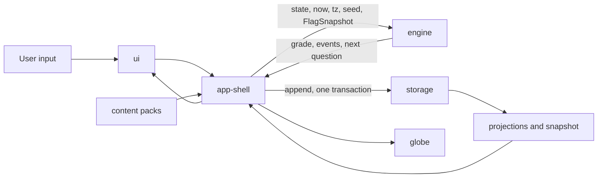

# 07 — Architecture and standards

**Status:** v1.0. Decisions: D7, D11, D96–D100, D103, D106, D107, D112–D120,
D123, D125, D130, D135, D153, D163, D178. `AGENTS.md` summarises this file.
If a feature file names a different path or package, the feature file wins.

## 1. Principles
1. Readable beats clever or efficient (D7).
2. Learning logic is pure TypeScript outside React (D98). Same input, same output on every platform.
3. The event log is the only source of truth. Everything else is a projection or a disposable cache (FE01).
4. Nothing about the user leaves the device (D103). The only network peer is the static pack host.
5. Anything that changes learning applies at a pause, never mid-round (D163).

## 2. Stack

| Area | Choice | Ref |
|------|--------|-----|
| Language | TypeScript `strict`, plus `noUncheckedIndexedAccess` and `exactOptionalPropertyTypes` | D96 |
| Workspace | pnpm workspaces, one lockfile, exact versions | D107 |
| UI | React, function components only | D98 |
| Globe and flat map | Three.js `WebGLRenderer` (WebGL2), pinned, upgraded in steps | D119, D130, D153 |
| Android shell | Capacitor 8 (targets API 36). `minSdk` 29 | D135 |
| Web storage | `@sqlite.org/sqlite-wasm`, `opfs-sahpool`, dedicated Worker | FE01 |
| Android storage | `@capacitor-community/sqlite`, WAL | FE01 |
| Validation | Zod at every boundary | FE01, FE02 |
| Messages | FormatJS ICU. en-GB source, en-US | FE05 |
| Memory model | `ts-fsrs`. Optimiser: `@open-spaced-repetition/binding-wasm32-wasip1` | FE13, FE17 |
| Geodesy (pipeline only) | geographiclib | D116 |
| Icons | Lucide through `<Icon>`, per-icon imports | D123 |
| Typeface | Atkinson Hyperlegible Next, self-hosted | D155 |
| Audio | AAC-LC `.m4a` | D156 |
| Content authoring | TOML, compiled into packs | D101 |
| Browser tests | Playwright, axe-core | 09 |
| Map maths and flat projection | d3-geo (`geoEqualEarth`, inverse projection, sphere maths) | D153 |
| Globe labels | troika-three-text | FE06 |
| Confirm by ADR in M0 | Build: Vite. Web offline: vite-plugin-pwa. Unit tests: Vitest. Property tests: fast-check. Lint: ESLint, Prettier. Android E2E driver. Tools runtime: Node LTS | – |

| Package | Version | Licence | Used by |
|---------|---------|---------|---------|
| `three` | 0.187.0 | MIT | FE06 (globe and flat map) |
| `d3-geo` | 3.1.2 | ISC | FE06 (flat map projection and inverse projection) |
| `troika-three-text` | 0.53.1 | MIT | FE06 (labels) |

A new runtime dependency needs a PR that adds it to the allowlist with a
reason (D107, AC-29.3). Never: analytics, ads, crash reporting, remote config
or any SDK that contacts a third party.

## 3. Repository layout

```text
/
├─ AGENTS.md
├─ apps/
│  ├─ web/            entry, service worker, CSP, e2e/
│  └─ android/        Capacitor project, manifest, native wrappers
├─ packages/
│  ├─ domain/         types, IDs, event schemas (Zod), upgraders
│  ├─ engine/         pure learning logic
│  │  ├─ memory/ selection/ session/ atlas/ daily/ metrics/ time/ geo/
│  │  ├─ random.ts    hash32 and seeded PRNG, with test vectors
│  │  └─ tuning.ts    every placeholder default
│  ├─ storage/        EventStore adapters, snapshots, diagnostics log
│  ├─ content/        pack loader, signature check, ContentView
│  ├─ app-shell/      orchestration, platform adapters, clock, event IDs
│  ├─ globe/          Three.js renderer, camera, picking
│  ├─ audio/          mixer, haptics bridge
│  └─ ui/             React screens, tokens.ts, Icon
├─ content/           authored data (layout in 04)
├─ experiments/       Exx.md pre-registrations
├─ tools/
│  ├─ content-pipeline/
│  ├─ sim-harness/    simulation harness (FE18)
│  └─ ci/             network, manifest, dependency and size audits
└─ docs/
   └─ spec/ adr/ diagrams/ backlog/ legal/ release/
```

## 4. Package boundaries (lint, CI gate 2)

| Package | May import | Must not |
|---------|-----------|----------|
| domain | Zod | Any other repo package |
| engine | domain. `engine/geo/` also d3-geo. `engine/memory/` also ts-fsrs and the binding | DOM, React, Three.js, storage, network, current time, current zone, `Math.random` |
| storage | domain | engine, ui |
| content | domain | engine, ui |
| app-shell | domain, engine, storage, content, audio | ui, React |
| globe | domain, `engine/geo`, Three.js, troika-three-text, d3-geo | React, storage |
| audio | domain | engine, storage |
| ui | domain, engine (pure read functions), app-shell, globe, audio | storage directly |
| apps/* | Anything | – |

Single-owner rules:
- Only `engine/memory/` imports `ts-fsrs` or the binding (AC-13.7).
- Only `engine/time/` does local-day maths (FE05).
- Only `storage` imports SQLite. Only `globe` imports Three.js.
- Only app-shell creates event IDs, reads the clock and zone, and reads flags.
  The engine gets a `FlagSnapshot` per round (FE03).
- Only `content` verifies pack signatures (FE02).

## 5. Data flow



**Answer:**
1. ui passes the raw response and timing to app-shell.
2. The engine grades it and returns geometry, outcome and rating (D117).
3. app-shell builds envelopes and appends them in one transaction before the next question shows (FE01).
4. Projections update incrementally. Snapshots are saved at pauses.

**Pause, in this order:**
1. `RoundEnded`.
2. Ready content pack (FE02).
3. Flags and experiments (FE03).
4. Perspective (FE07).
5. Adopted parameters, then full memory replay (FE17).
6. Settings that apply at the next pause (FE23).
7. Web app update, if one is ready and no round is open (FE31).
8. Build the next round.

**Launch:** load the snapshot, or rebuild from the log on any mismatch (FE01).

**Workers (web):** storage and metrics run in one dedicated Worker. The
optimiser runs in its own Worker (FE17). The main thread never blocks on either.

## 6. Determinism
- Engine functions are pure. Time, zone and seed are always arguments.
- Randomness only from `engine/random.ts`, seeded from the round seed stored in `AnswerRecorded`.
- Event order is always (`at`, `id`).
- Replays use stored geometry and ratings. They never regrade (D117).
- Values used for ordering are rounded to 9 significant figures before
  comparison. Ties break by `ItemFacetKey`. JavaScript engines may differ in
  the last bit of `Math.exp` and `Math.pow`, and this keeps web and Android identical (CI gate 3).

## 7. Coding rules (CI blocks where it can, D96)
1. No `any`. No non-null `!` outside tests. `as` only in branded-type constructors.
2. Expected failures return `Result<T, E>`, where `E` is a union with a `kind` field. Throw only for bugs.
3. Zod validates every boundary: storage reads, imports, packs, settings and Worker messages. Inside, trust the types.
4. Engine: no I/O, no globals, never mutates its inputs.
5. Placeholder defaults live only in `engine/tuning.ts`. Packs override them only where a feature allows it.
6. Named exports only. Lint warns on functions over 60 lines and files over 400.
7. US spelling in identifiers (D99). Full words. Abbreviations only if they're in the glossary.
8. No user-facing text in code. FormatJS keys only. Never join fragments (AC-05.8).
9. Colours only from tokens (D125). Icons only through `<Icon>` (D123).
10. Interactive elements come from ui primitives, with labels and touch targets of at least 48 px.
11. Feature code never checks the build channel. Use `FlagReader`. The developer panel is removed at compile time (AC-03.3).
12. A payload change means a new `schema` version, an upgrader and a fixture, kept for ever (FE01).
13. Comments explain why and cite D, FE or AC IDs.
14. Every AC has a test whose name starts with its ID (`AC-13.4 …`). Property tests log their seed.
15. Times are UTC ms numbers. No `Date` objects in the domain or engine.
16. No TypeScript `enum`. Use string literal unions and discriminated unions with exhaustive checks.
17. No default exports, no deep barrel files.
18. No global mutable state or singletons. Classes only for adapters and `GlobeController`, never inheritance.
19. No floating promises, no empty `catch`.
20. Learning data only through `EventStore`. Never `localStorage` or IndexedDB.
21. TOML for facts, GeoJSON for shapes. No YAML.
22. Commits follow Conventional Commits.

## 8. Coordinates and geometry (D112–D120)
- Stored as WGS 84 `{ lng, lat }` decimal degrees, at most 6 decimals. Branded `LngLat`. Pairs only in GeoJSON I/O.
- Game maths on a sphere, R = 6,371.0088 km. Metres, degrees, bearings clockwise from true north.
- Published distances come from geographiclib in the pipeline and are shown rounded.
- Projections are for drawing only. Flat-map taps are graded through the inverse projection (D153).
- Taps are graded by the engine against pipeline tap zones (D118).
- 180° splits exist only in source GeoJSON (D120).

## 9. Errors and diagnostics
- User-facing errors use the screens named in features (S19, S20, S21). Never a raw message.
- Technical details go to the diagnostics log only (FE04). Never answers or free text.
- No error leaves the device unless the user sends diagnostics (FE04, FE30).

## 10. Security (D107)
- Packs are Ed25519-signed, with the current and next keys embedded (FE02).
- Web CSP: `default-src 'self'`; `connect-src 'self'` plus the pack host;
  `script-src 'self' 'wasm-unsafe-eval'`; `worker-src 'self'`; no inline
  scripts. CI checks the deployed headers.
- No `eval` and no dynamic code loading. All assets are self-hosted (D103).
- Signing keys are kept offline with a backup. Play App Signing is used for Android.

## 11. ADRs
One record per technical choice in `docs/adr/`, numbered when written. Open
ADRs are listed in each milestone's setup tasks.
